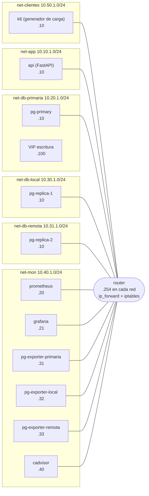
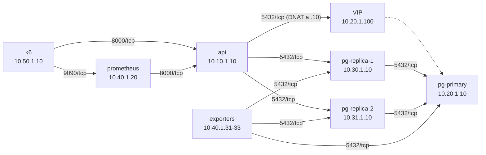

# Topología de red — DB Scale Lab

Diagrama de las 6 redes Docker segmentadas y el router Linux que las conecta (Fase 1). Todo el tráfico entre segmentos pasa por el router: cada nodo tiene como ruta por defecto la IP `.254` de su propia subred, y el router decide, con `iptables`, qué tráfico deja pasar.

## 1. Redes y nodos



## 2. Flujo de tráfico permitido

Solo estos flujos están habilitados en el firewall; todo lo demás se descarta (`FORWARD DROP` por defecto).



## 3. Tabla de segmentos

| Red | Subred | Gateway Docker | Router | Propósito |
|---|---|---|---|---|
| `net-clientes` | 10.50.1.0/24 | .253 | .254 | Clientes (generador de carga k6) |
| `net-app` | 10.10.1.0/24 | .253 | .254 | Aplicación (API) |
| `net-db-primaria` | 10.20.1.0/24 | .253 | .254 | PostgreSQL primario (escrituras) + VIP |
| `net-db-local` | 10.30.1.0/24 | .253 | .254 | Réplica de lectura, sede principal |
| `net-db-remota` | 10.31.1.0/24 | .253 | .254 | Réplica de lectura, sede remota (con latencia inyectada) |
| `net-mon` | 10.40.1.0/24 | .253 | .254 | Monitoreo: Prometheus, Grafana, exporters, cAdvisor |

Las 6 redes se declaran con `driver_opts`: `com.docker.network.bridge.gateway_mode_ipv4: nat-unprotected` y `com.docker.network.bridge.enable_ip_masquerade: "false"` — permiten que el tráfico de tránsito llegue al router (algo que la red `nat` por defecto de Docker no deja pasar, verificado en el entorno), sin darle a ninguna red salida directa a Internet.

## 4. Tabla de reglas del firewall

Política del router: `FORWARD DROP` por defecto, `ESTABLISHED,RELATED` permitido, y solo estas reglas de entrada:

| Origen | Destino | Puerto | Motivo |
|---|---|---|---|
| net-clientes (k6, 10.50.1.10) | api (10.10.1.10) | 8000/tcp | Tráfico de prueba hacia la API |
| net-clientes (k6, 10.50.1.10) | prometheus (10.40.1.20) | 9090/tcp | Envío de métricas de k6 (remote write) |
| api (10.10.1.10) | pg-primary (vía VIP 10.20.1.100 → 10.20.1.10), pg-replica-1 (10.30.1.10), pg-replica-2 (10.31.1.10) | 5432/tcp | Escrituras y lecturas |
| pg-replica-1, pg-replica-2 | pg-primary (10.20.1.10) | 5432/tcp | Replicación en streaming |
| exporters de net-mon (10.40.1.31, .32, .33) | pg-primary, pg-replica-1, pg-replica-2 | 5432/tcp | Métricas de base de datos |
| prometheus (10.40.1.20) | api (10.10.1.10) | 8000/tcp | Métricas de la aplicación (`/metrics`) |

Todo lo demás se descarta. En particular: las redes de base de datos nunca inician conexión hacia la aplicación ni hacia los clientes, y los clientes no pueden alcanzar ninguna base de datos directamente.

**VIP de escritura:** la aplicación escribe contra `10.20.1.100:5432`, una dirección virtual dentro de `net-db-primaria` que el router traduce (DNAT, tabla `nat`) hacia el primario activo (`10.20.1.10`). No hay SNAT: la IP de origen real se conserva, de modo que `pg_hba.conf` pueda filtrar por subred de origen en fases posteriores. El failover (fase 4) cambia el destino del DNAT hacia la réplica promovida, sin tocar la aplicación.

## 5. Modo de diagnóstico del firewall (`FIREWALL_MODE`)

El firewall estricto (`FIREWALL_MODE=strict`, el valor por defecto) bloquea ICMP igual que cualquier otro tráfico no listado arriba — lo cual choca con el criterio A1.4 (probar que el ping entre segmentos pasa por el router). Para resolverlo sin aflojar el firewall real, `firewall.sh` acepta `FIREWALL_MODE=permisivo`, que agrega **únicamente** una regla de `ACCEPT` para ICMP, sin tocar ninguna de las reglas de negocio de la tabla anterior. Se usa así, sin recrear el contenedor:

```bash
docker compose exec router sh -c 'FIREWALL_MODE=permisivo firewall.sh'   # activa ICMP, para A1.4
docker compose exec router firewall.sh                                   # vuelve a strict, para A1.5 en adelante
```

A1.4 (ping/traceroute entre segmentos) se verifica en modo permisivo; A1.5 en adelante (incluida la demo real) se verifica siempre en modo estricto.

## 6. Resultado verificado de D3 / D3b

D3 quedó **completamente verificado** en Fase 1: con `nat-unprotected` + `enable_ip_masquerade: "false"` el ruteo entre segmentos funciona (A1.4), la publicación de puertos al host funciona (A1.8: un nodo de prueba en `net-mon` con `ports: "3000:80"` respondió a `nc -zv -w2 localhost 3000`), y ninguna red tiene salida a Internet (A1.6: `ping -c1 -W2 1.1.1.1` falló desde `t-clientes`, `t-db` y el propio router). El plan B **D3b no hizo falta aplicarlo**.

## 7. Diagrama de la arquitectura real (Fase 6)

`diagramas/imagen-diagrama.png` es la versión renderizada (PNG) de esta misma topología, tomada directamente de `demo/docker-compose.yml` y de las decisiones D1-D32 (no de la propuesta original): las 6 subredes de arriba, el router, la VIP de escritura, el primario, las dos réplicas y el bloque de monitoreo, con el patrón de sidecars (D5) indicado. Es la imagen que usan el documento final y el póster.
